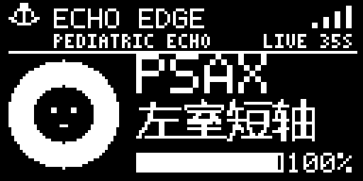

<div align="center">

# Echo Edge · 儿童心超研究工作站

Four ends in one room: a Windows web workstation, a FastAPI backend, research echo models on a local GPU, and an ESP32-S3 bed-side panel that takes hints over USB serial.

四端在同一间屋子里：Windows 上的网页工作站、FastAPI 后端、本机 GPU 上的心超研究模型，以及一块通过 USB 串口接收提示的 ESP32-S3 床旁终端。

[](requirements.txt)
[](docs/WORKSTATION_TERMINAL.md)
[](requirements.txt)
[-orange.svg)](docs/WORKSTATION_TERMINAL.md)



<sub>The 128×64 bed-side panel render from `firmware/echo-panel`: it shows the latest view result and speaks it through SYN6288E.<br/>`firmware/echo-panel` 里的 128×64 床旁面板渲染图：显示最近一次切面结论，并通过 SYN6288E 念出来。</sub>

</div>

> **How to read this page / 怎么读这页**
> English first, then the same content in Chinese — not a summary, not a separate version. Tables keep both languages in one cell.
> 每段英文在前，同一内容的中文紧跟在后；不是摘要，也没有单独的中文版。表格把两种语言放进同一格。

---

## At a glance · 一眼看懂

| | |
|---|---|
| **Problem<br/>问题** | A pediatric echo model that only lives in a notebook cannot be reviewed at the bed side, and a demo that only runs on synthetic clips says nothing about whether the pipeline handles real DICOM cine, colour Doppler or variable frame intervals.<br/>只活在 notebook 里的儿童心超模型，在床旁没法复核；只在合成片段上跑通的演示，也说明不了管线能不能处理真实 DICOM cine、彩色多普勒和变帧间隔。 |
| **Fix<br/>做法** | Four ends wired to one database and one serial link: web (create exam, import video, read frames), API (permissions, media originals, SQLite records, serial), models (view classification, four-chamber segmentation, quality, ejection fraction), terminal (OLED panel plus voice, `HINT` in and `ACK` back).<br/>四端接到同一个数据库和一条串口上：网页（建检查、导入视频、阅帧）、API（权限、媒体原件、SQLite 记录、串口）、模型（切面识别、四腔分割、质量、射血分数）、终端（OLED 面板加语音，收 `HINT` 回 `ACK`）。 |
| **Cost<br/>代价** | Windows x64 with PowerShell, Python 3.13, a CUDA GPU (verified here on an RTX 5060 Laptop with 8 GB), roughly 1.9 GB of CUDA PyTorch downloads, and an ESP32-S3 board for the terminal end. Weights live in this repository's Releases and need repository access.<br/>Windows x64 加 PowerShell、Python 3.13、一块 CUDA GPU（这里在 RTX 5060 Laptop 8 GB 上验证）、约 1.9 GB 的 CUDA PyTorch 下载，以及终端那端的 ESP32-S3 板子。权重在本仓库的 Release 里，需要仓库权限。 |
| **Not<br/>不是** | Not a diagnostic device, not regulatory-cleared software, and not clinically validated: there is no clinical-accuracy evaluation yet, and every model here is labelled as research use.<br/>不是诊断设备、没有器械认证、也没有临床验证：目前没有临床准确率评估，这里每个模型都标为研究用途。 |

## The problem · 问题在哪

The loop that matters is not "get a prediction". It is: create an exam, attach the original cine, run a model, keep the frame the result came from, let a clinician read it again tomorrow, and push one line of text to a device at the bed side. Each of those steps can pass alone and break in the join.

真正要跑的环路不是"出一个预测"，而是：建检查、挂上原始 cine、跑模型、保留结论来自哪一帧、让医生明天还能重新打开，再把一行文字推到床旁的设备上。每一步单独都能过，连起来就会断。

Two constraints shape the repository. Patient video cannot enter Git, so originals, filled annotation workbooks, patient mapping tables, frame caches and run directories are all ignored, and only code, pinned dependency versions, blank templates and documents are tracked. Model weights follow the same rule: they are attached to Releases, not committed.

两个约束决定了这个仓库的形状。病人影像不能进 Git，所以原始影像、填好的标注工作簿、患者关联表、抽帧缓存和训练目录都被忽略，只跟踪代码、固定的依赖版本、空白模板和文档。模型权重同理：挂在 Release 上，不提交进仓库。

The rest of the design follows from the review requirement: an analysis is a job with a state, a failure keeps its reason, and the panel only ever displays the most recent finished result — it never guesses.

其余设计来自复核需求：分析是一个带状态的任务，失败会保留原因，面板只显示最近一条已完成的结果——它不做猜测。

## The idea · 思路

| Noun · 名词 | Where · 位置 | Rule · 规则 |
|---|---|---|
| **Exam**<br/>检查 | `backend/clinical.py`, `frontend/` | Every analysis belongs to one exam and one patient; parameters are stored per exam, not globally.<br/>每次分析都归属一个检查和一个患儿；参数按检查保存，不做全局默认。 |
| **Analysis job**<br/>分析任务 | `backend/analysis_jobs.py` | Asynchronous, with explicit states; an interrupted job is recovered as `interrupted`, not silently retried.<br/>异步、状态显式；中断的任务恢复为 `interrupted`，不静默重试。 |
| **Weights**<br/>权重 | GitHub Releases | Engines, checkpoints and reports are release attachments; the inference entry re-checks GPU, TensorRT version and engine SHA-256.<br/>引擎、检查点与报告是 Release 附件；推理入口会复核 GPU、TensorRT 版本与引擎 SHA-256。 |
| **Data boundary**<br/>数据边界 | `data/`, `work/`, `runs/` (ignored) | Originals, annotations and caches stay in the authorised environment; nothing patient-related is committed.<br/>原始影像、标注与缓存留在授权环境里；任何与患者相关的文件都不提交。 |
| **Terminal**<br/>终端 | `firmware/edge-terminal/`, `backend/terminal_link.py` | Receives `HINT`, returns `ACK`. It does no inference and no acquisition — it is a display that talks.<br/>收 `HINT`、回 `ACK`。它不推理、不采集——是一块会说话的显示器。 |
| **Research label**<br/>研究标签 | Releases, `docs/` | Non-commercial research use only; dataset licences are recorded, and the stricter reading wins where sources disagree.<br/>仅限非商业研究；数据集许可逐项记录，来源冲突时按更严格的口径执行。 |

The practical test of the chain: import a public teaching clip, run the view model, save, refresh the page and read the result back, then send a hint and watch the terminal return its receipt. That exact sequence is the one recorded as exercised.

这条链路最实际的验证方式：导入一段公开教学片段、跑切面模型、保存、刷新页面读回结果，然后发一条提示，看终端是否回执。被记为"已实测"的就是这一串动作。

## Capabilities · 能力清单

Models, with the numbers as recorded in this repository's own reports:

模型与记录在仓库自己报告里的数字：

| Model · 模型 | Data · 数据 | Recorded result · 记录的结果 | Where the record is · 记录在哪 |
|---|---|---|---|
| A4C/PSAX view classification<br/>切面识别 | EchoNet-Pediatric | FP16 TensorRT engine; output is the view, per-class mean probability and the number of sampled frames.<br/>FP16 TensorRT 引擎；输出切面、两类平均概率与抽样帧数。 | [docs/MODEL_EVALUATION.md](docs/MODEL_EVALUATION.md), release `stanford-fp16-epoch10` |
| LV endocardium segmentation<br/>左室分割 | EchoNet-Pediatric fold 0 — 186 patients, 658 videos, 1,298 traced frames<br/>EchoNet-Pediatric 折 0——186 名患儿、658 段视频、1,298 个有描迹帧 | Frame-level Dice 0.9047, IoU 0.8323; per-patient Dice 0.9074.<br/>帧级 Dice 0.9047、IoU 0.8323；按患儿平均 Dice 0.9074。 | [docs/STANFORD_LV_MODEL.md](docs/STANFORD_LV_MODEL.md), release `stanford-lv-epoch8` |
| Four-chamber segmentation<br/>四腔分割 | CardiacUDC — 293 A4C videos, 2,257 annotated frames, two hospitals<br/>CardiacUDC——293 段 A4C 视频、2,257 张标注帧、两家医院 | Independent test (43 groups / 367 frames): LV 0.8243, LA 0.8279, RA 0.8841, RV 0.8420; foreground mean Dice 0.8446 frame-level, 0.7300 group macro.<br/>独立测试（43 组 / 367 帧）：LV 0.8243、LA 0.8279、RA 0.8841、RV 0.8420；前景平均 Dice 帧级 0.8446、组级 0.7300。 | [docs/CARDIACUDC.md](docs/CARDIACUDC.md), release `cardiacudc-fourchamber-v1` |
| Structures, quality grade and EF<br/>结构、质量与射血分数 | CAMUS — 500 patients, 2CH/4CH, ED/ES masks, quality grades<br/>CAMUS——500 名病人、2CH/4CH、ED/ES 掩膜、质量分级 | Held-out 50 patients / 200 frames: LV endocardium Dice 0.9275, myocardium 0.8553, left atrium 0.8835, foreground mean 0.8888; image-quality patient-view macro-F1 0.591.<br/>留出 50 名病人 / 200 帧：左室心内膜 Dice 0.9275、心肌 0.8553、左房 0.8835、前景平均 0.8888；影像质量患者-视位 macro-F1 0.591。 | [docs/CAMUS.md](docs/CAMUS.md), release `camus-structure-quality-v1` |
| EF regression<br/>EF 回归 | EchoNet-Pediatric | Patient-level MAE 3.80; AUROC 0.996 for EF < 50% on 5 positives — direction only, not a screening claim.<br/>患儿级 MAE 3.80；EF < 50% 的 AUROC 0.996 只基于 5 例阳性——只是方向性证据，不是筛查结论。 | [docs/STANFORD_EF.md](docs/STANFORD_EF.md), release `stanford-ef-epoch5` |

These figures are quoted from the reports linked above. This rewrite did not re-run any training or evaluation.

这些数字引自上面链接的报告。这次改写没有重跑任何训练或评估。

| End · 端 | Path · 路径 | What it does · 做什么 |
|---|---|---|
| Web<br/>网页 | `frontend/` | React 19 + Vite: exam creation, video import and playback, four-chamber overlay, terminal receipts. Default `http://127.0.0.1:5181/`.<br/>React 19 + Vite：建检查、导入与播放视频、四腔叠图、终端回执。默认 `http://127.0.0.1:5181/`。 |
| API<br/>接口 | `backend/` | FastAPI + SQLAlchemy + Alembic: permissions, media originals, SQLite analysis records, serial link. Default `http://127.0.0.1:8019/`.<br/>FastAPI + SQLAlchemy + Alembic：权限、媒体原件、SQLite 分析记录、串口链路。默认 `http://127.0.0.1:8019/`。 |
| Models<br/>模型 | root scripts | `train_echo.py`, `train_stanford_lv.py`, `train_stanford_ef.py`, `train_camus.py`, `train_cardiacudc.py`, `infer_stanford.py`, `evaluate_echo.py`, `benchmark_echo.py`.<br/>训练、推理、评估与测速入口各一支脚本。 |
| Terminal<br/>终端 | `firmware/` | ESP32-S3 EdgeTerminal plus the `echo-panel`, `ecw-*`, `sensor-hub` and `probe` sketches; Python helpers under `firmware/tools/`.<br/>ESP32-S3 的 EdgeTerminal，以及 `echo-panel`、`ecw-*`、`sensor-hub`、`probe` 几个 sketch；`firmware/tools/` 下是 Python 辅助脚本。 |

## Quickstart · 快速开始

### Requirements · 环境要求

| Item · 项目 | Verified configuration · 已验证配置 |
|---|---|
| OS · 系统 | Windows x64, PowerShell<br/>Windows x64、PowerShell |
| Python | 64-bit Python 3.13.13<br/>64 位 Python 3.13.13 |
| GPU · 显卡 | RTX 5060 Laptop 8 GB, NVIDIA driver 582.05. Training, `verify-media` and the GPU benchmark need CUDA; `preflight` runs on CPU.<br/>RTX 5060 Laptop 8 GB、NVIDIA 驱动 582.05。训练、`verify-media` 和 GPU 测速需要 CUDA；`preflight` 可以在 CPU 上跑。 |
| PyTorch | `torch 2.12.1+cu130`, `torchvision 0.27.1+cu130` from the official CUDA 13.0 index<br/>从 PyTorch 官方 CUDA 13.0 索引安装 |
| Inference · 推理 | `tensorrt-cu13==10.16.1.11`, `onnx==1.22.0`, `onnxruntime-gpu==1.27.0` |
| Disk · 磁盘 | About 1.9 GB for the CUDA PyTorch download, plus caches, extracted frames and checkpoints<br/>CUDA 版 PyTorch 下载约 1.9 GB，另需缓存、抽帧与检查点空间 |

### 1. Python environment · Python 环境

```powershell
py -3.13 -m venv .venv
$python = '.\.venv\Scripts\python.exe'
& $python -m pip install torch==2.12.1+cu130 torchvision==0.27.1+cu130 --index-url https://download.pytorch.org/whl/cu130
& $python -m pip install -r requirements.txt --index-url https://pypi.org/simple
& $python -m pip check
```

### 2. Verify the GPU path · 验证 GPU 路径

```powershell
& $python -c "import torch, torchvision; assert torch.cuda.is_available(); print(torch.__version__, torchvision.__version__, torch.version.cuda, torch.cuda.get_device_name(0)); print(torch.arange(16, device='cuda').square().sum().item())"
```

The last value must be `1240`; a different number or an assertion error means the CUDA wheel and the driver do not match. For CPU-only preflight work, install the `+cpu` wheels from the CUDA-free index instead.

最后一行的值必须是 `1240`；数字不对或断言失败，说明 CUDA wheel 与驱动不匹配。只做 CPU 预检时改装 `+cpu` 的 wheel。

### 3. Get weights and run one video · 取权重跑一段视频

```powershell
$releaseDir = '.\work\stanford-fp16-epoch10'
gh release download stanford-fp16-epoch10 `
  --repo songconmaisaix31-design/echo-edge-training `
  --dir $releaseDir `
  --pattern 'Stanford-A4C-PSAX-TensorRT-FP16.engine' `
  --pattern 'Stanford-TensorRT-FP32-FP16-test.json'

$engineReport = Join-Path $releaseDir 'Stanford-TensorRT-FP32-FP16-test.json'
& $python -X utf8 .\infer_stanford.py predict --engine-report $engineReport --video $video --precision fp16
```

A successful run prints one JSON object with `precision` `fp16`, a `view` of `A4C` or `PSAX`, `sampled_frames` and per-class `probabilities`.

成功时输出一条 JSON，`precision` 为 `fp16`，`view` 为 `A4C` 或 `PSAX`，另有 `sampled_frames` 和两类平均概率。

### 4. Run the whole workstation · 跑整台工作站

The deployment walkthrough — two Python environments, migrations, the first operator account, the web and API ports, and the four-end acceptance — is in [docs/WORKSTATION_TERMINAL.md](docs/WORKSTATION_TERMINAL.md). Before training on team data, run the preflight gate and read its report:

完整部署步骤——两个 Python 环境、迁移、首个操作员账号、网页与 API 端口、四端验收——在 [docs/WORKSTATION_TERMINAL.md](docs/WORKSTATION_TERMINAL.md)。用团队数据训练之前，先跑预检闸门并读报告：

```powershell
& $python -X utf8 .\train_echo.py train @config --preflight-only
```

Exit code `0` means the data passed; `1` means the report found a problem. The report names the worksheet row, the relative media path and the source frame time.

退出码 `0` 表示数据通过；`1` 表示报告发现问题。报告会指出工作表行号、影像相对路径和源帧时间。

## Documentation · 文档

| Doc · 文档 | Read it when · 什么时候读 |
|---|---|
| [docs/WORKSTATION_TERMINAL.md](docs/WORKSTATION_TERMINAL.md) | Deploying the four ends on one Windows machine.<br/>在一台 Windows 上部署四端。 |
| [docs/MODEL_EVALUATION.md](docs/MODEL_EVALUATION.md) | Locked evaluation, ONNX checks and the video inference path.<br/>锁定模型后的评估、ONNX 核对与视频推理路径。 |
| [docs/EVALUATION.md](docs/EVALUATION.md) | Per-patient evaluation and the read-only Stanford fold review.<br/>按患儿评估与 Stanford 分折只读核查。 |
| [docs/CAMUS.md](docs/CAMUS.md), [docs/CARDIACUDC.md](docs/CARDIACUDC.md) | The two public datasets and their segmentations.<br/>两个公开数据集与对应分割能力。 |
| [docs/ECHONET_PEDIATRIC.md](docs/ECHONET_PEDIATRIC.md), [docs/STANFORD_LV_MODEL.md](docs/STANFORD_LV_MODEL.md), [docs/STANFORD_EF.md](docs/STANFORD_EF.md) | Stanford-side training prep, the LV model, the EF model.<br/>Stanford 侧训练准备、左室模型、EF 模型。 |
| [docs/TRAINING_DATA.md](docs/TRAINING_DATA.md) | What to deliver and how the workbook is filled.<br/>交什么数据、工作簿怎么填。 |
| [docs/DOCTOR_REVIEW.md](docs/DOCTOR_REVIEW.md) | The clinician review flow.<br/>医生复核流程。 |
| [docs/PUBLIC_DATASETS.md](docs/PUBLIC_DATASETS.md) | Availability, licences and citations for every public source.<br/>每个公开数据源的可下载性、许可与引用。 |
| [docs/ESP32_TERMINAL.md](docs/ESP32_TERMINAL.md), [docs/firmware/](docs/firmware) | Terminal plan, wiring, pin limits, I²C addresses, ECW registers and pitfalls.<br/>终端方案、接线、引脚禁区、I²C 地址、ECW 寄存器与踩坑记录。 |
| [docs/V1_E2E_ACCEPTANCE.md](docs/V1_E2E_ACCEPTANCE.md) | The full end-to-end acceptance record, module by module.<br/>逐模块的全系统端到端验收记录。 |
| [docs/batch-01/](docs/batch-01) | The first batch: cleaning report, selected-frame index, expert handoff.<br/>第 01 批：清洗报告、抽帧索引、专家交接。 |
| [reference/README.md](reference/README.md) | The vendor competition kit's module definitions and wiring.<br/>厂商参赛套件的模块定义与接线。 |

## Repository layout · 仓库结构

```text
echo-edge-training/
├── backend/                # FastAPI app, SQLAlchemy models, Alembic migrations, tests
├── frontend/               # React 19 + Vite workstation UI
├── firmware/
│   ├── edge-terminal/      # ESP32-S3: receives HINT, returns ACK
│   ├── echo-panel/         # 128×64 OLED + SYN6288E voice panel
│   └── ecw-*/ sensor-hub/ probe/ tools/
├── Start-EchoEdge.ps1      # local launcher; -Lan and Stanford variants next to it
├── train_echo.py           # team dual-head fine-tune + preflight gate
├── train_stanford_lv.py    # left-ventricle segmentation
├── train_stanford_ef.py    # ejection fraction regression
├── train_camus.py          # CAMUS structures, quality, EF
├── train_cardiacudc.py     # four-chamber segmentation
├── infer_stanford.py       # TensorRT FP16 video inference
├── evaluate_echo.py        # locked evaluation and ONNX checks
├── benchmark_echo.py       # decode/preprocess/GPU timing
├── echo_dicom.py           # DICOM cine reading
├── templates/              # blank annotation workbook
├── docs/                   # deployment, models, data, firmware, acceptance
└── reference/moce-kit/     # vendor kit module definitions
```

## Status · 状态

Recorded as exercised: importing public teaching videos, running inference, saving results, reading them back after a refresh, and the terminal receiving a command. `docs/V1_E2E_ACCEPTANCE.md` records 6 backend pytest cases passing plus a TypeScript and Vite build, with one module left as BLOCKED — the exam-switch control was never asserted in the browser.

记为已实测的部分：导入公开教学视频、跑推理、保存结果、刷新后读回，以及终端收到命令。`docs/V1_E2E_ACCEPTANCE.md` 记录后端 pytest 6 项通过、TypeScript 与 Vite 构建通过，同时有一个模块仍是 BLOCKED——检查切换控件没有在浏览器里完成断言。

Known limits, stated rather than hidden:

边界写出来而不是藏起来：

- **No clinical accuracy claim.** Nothing here has been evaluated against clinical ground truth; the models are research artefacts.
- **Team data is not validated.** Two-dimensional colour Doppler, variable frame intervals, formal annotations and the resulting fine-tune still have to be exercised on real hospital data.
- **Formal feedback acceptance is open.** The terminal feedback loop still needs a frozen dual-head model, three classes of real video and continuous linkage records.
- **No CI.** The repository has no `.github/workflows`, so there is no CI badge on this page; `pytest` is run by hand. Test counts above are the numbers recorded in the acceptance document, not a run repeated for this rewrite.
- **No licence file.** There is no `LICENSE` at the repository root; see below.

- **不做临床准确率声明。** 这里的东西没有和临床真值对照评估过；模型是研究产物。
- **团队数据没有验证。** 二维彩色多普勒、变帧间隔、正式标注以及由此得到的微调，仍需在真实院方数据上跑过。
- **正式反馈验收还没关。** 终端反馈闭环仍需要冻结的双头模型、三类真实视频和连续联动记录。
- **没有 CI。** 仓库里没有 `.github/workflows`，所以这页不放 CI 徽章；`pytest` 是手工跑的。上面的测试数字是验收文档里记录的数字，不是这次改写重跑的。
- **没有许可文件。** 仓库根目录没有 `LICENSE`，见下。

## License · 许可

There is no `LICENSE` file, so the code is not offered under an open licence. Model weights, engines and reports are distributed through this repository's Releases for non-commercial research to members with repository access. Third-party datasets keep their own terms; where a source's licence is ambiguous, the stricter reading is applied.

仓库里没有 `LICENSE` 文件，所以代码没有以开源许可提供。模型权重、引擎与报告通过本仓库的 Release 提供给有权限的成员，仅限非商业研究。第三方数据集沿用各自条款；来源许可存在歧义时，按更严格的口径执行。
